# Kubernetes Cluster Lab on Windows

### Building a Three-Node Kubernetes Cluster Using Docker Desktop and kind

<p align="center">
  
  
  
  
</p>

---

## 1. Project Overview

This project demonstrates the creation and management of a multi-node Kubernetes cluster on a Windows machine using **Docker Desktop and kind (Kubernetes IN Docker)**.

A three-node Kubernetes cluster is created, consisting of one Control Plane node and two Worker nodes.

An NGINX web application is deployed inside the cluster using Kubernetes Deployments. The experiment further demonstrates application scaling from three to six replicas and Kubernetes self-healing by deleting a running Pod and observing its automatic replacement.

The entire implementation is performed locally without requiring cloud infrastructure or multiple physical machines.

## 2. Objectives

* Understand Kubernetes architecture and container orchestration.
* Create a three-node Kubernetes cluster using kind.
* Understand the roles of Control Plane and Worker nodes.
* Deploy an NGINX application using Kubernetes Deployments.
* Monitor Pods and their distribution across Worker nodes.
* Perform horizontal scaling from three to six replicas.
* Demonstrate Kubernetes self-healing through automatic Pod replacement.
* Understand how Docker containers are used to run Kubernetes nodes.

## 3. Technologies Used

| Technology     | Purpose                               |
| :------------- | :------------------------------------ |
| Windows 10/11  | Host operating system                 |
| WSL 2          | Linux environment for Docker Desktop  |
| Docker Desktop | Container runtime environment         |
| Kubernetes     | Container orchestration platform      |
| kind           | Creates a local Kubernetes cluster    |
| kubectl        | Command-line tool for Kubernetes      |
| NGINX          | Web server deployed inside Kubernetes |
| YAML           | Cluster configuration                 |

## 4. Kubernetes Architecture

The experiment uses a three-node Kubernetes cluster.

### Architecture Diagram

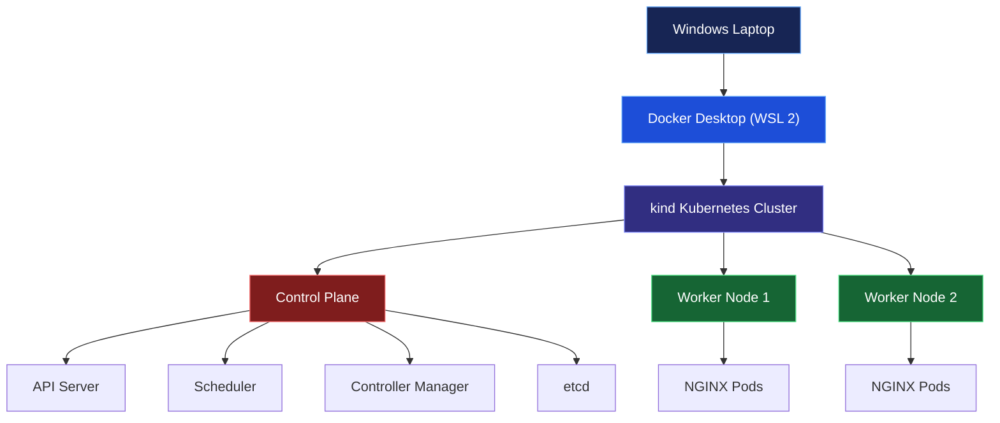

### Node Configuration

| Node               | Role          | Responsibility                 |
| :----------------- | :------------ | :----------------------------- |
| kind-control-plane | Control Plane | Manages the Kubernetes cluster |
| kind-worker        | Worker        | Executes application workloads |
| kind-worker2       | Worker        | Executes application workloads |

All three nodes run as Docker containers on the local Windows machine.

### Control Plane Components

| Component          | Function                               |
| :----------------- | :------------------------------------- |
| API Server         | Handles communication and API requests |
| Scheduler          | Assigns Pods to suitable nodes         |
| Controller Manager | Maintains the desired cluster state    |
| etcd               | Stores Kubernetes cluster data         |

## 5. Project Structure

```text
Kubernetes-Cluster-Lab/
│
├── README.md
│
├── kind-config.yaml
│
└── results/
    │
    ├── 01-docker-version.png
    ├── 02-docker-hello-world.png
    ├── 03-cluster-creation.png
    ├── 04-cluster-nodes.png
    ├── 05-docker-containers.png
    ├── 06-kubernetes-system-pods.png
    ├── 07-nginx-deployment.png
    ├── 08-nginx-pods.png
    ├── 09-scaling-to-six.png
    └── 10-self-healing.png
```

## 6. Cluster Configuration

The cluster is configured using `kind-config.yaml`.

### Configuration File

```yaml
kind: Cluster
apiVersion: kind.x-k8s.io/v1alpha4

nodes:
  - role: control-plane
  - role: worker
  - role: worker
```

### Configuration Explanation

| Parameter     | Description                                  |
| :------------ | :------------------------------------------- |
| kind: Cluster | Defines the resource type                    |
| apiVersion    | Specifies the kind configuration API version |
| control-plane | Creates one Control Plane node               |
| worker        | Creates the first Worker node                |
| worker        | Creates the second Worker node               |

This configuration instructs kind to create a Kubernetes cluster with one Control Plane and two Worker nodes.

## 7. Implementation Workflow

The experiment is performed in the following stages.

### Part 1: Installation of Required Tools

The following tools are installed:

1. WSL 2
2. Docker Desktop
3. kubectl
4. kind

Docker Desktop is configured to use the WSL 2 backend.

### Part 2: Verification of Tools

The installations are verified using:

```powershell
docker version
docker run hello-world
kubectl version --client
kind version
```

These commands verify Docker functionality and the availability of kubectl and kind.

### Part 3: Creating the Cluster Configuration

A project directory is created, and the `kind-config.yaml` file is added.

The configuration specifies one Control Plane and two Worker nodes.

### Part 4: Creating the Kubernetes Cluster

The cluster is created using:

```powershell
kind create cluster --config kind-config.yaml
```

kind reads the YAML configuration and creates three Docker containers representing the Kubernetes nodes.

The Worker nodes join the Control Plane to form the cluster.

Cluster connectivity is verified using:

```powershell
kubectl cluster-info --context kind-kind
```

Node status is checked using:

```powershell
kubectl get nodes
```

### Part 5: Deploying the NGINX Application

An NGINX Deployment is created with three replicas.

```powershell
kubectl create deployment web --image=nginx --replicas=3
```

Kubernetes creates the required Pods and schedules them on available Worker nodes.

Verify the Deployment:

```powershell
kubectl get deployments
```

Check the Pods:

```powershell
kubectl get pods -o wide
```

The output displays Pod names, status, IP addresses, and node assignments.

### Part 6: Scaling and Self-Healing

#### A. Horizontal Scaling

Initially, the NGINX application runs with three replicas.

The number of replicas is increased to six using:

```powershell
kubectl scale deployment web --replicas=6
```

Verify the Deployment:

```powershell
kubectl get deployments
```

Check the Pods:

```powershell
kubectl get pods -o wide
```

Kubernetes creates three additional Pods to reach the desired replica count.

#### B. Self-Healing

To demonstrate self-healing, one running Pod is manually deleted.

First, list the Pods:

```powershell
kubectl get pods
```

Delete a selected Pod:

```powershell
kubectl delete pod <pod-name>
```

Observe the changes:

```powershell
kubectl get pods -w
```

The ReplicaSet controller detects that the actual number of Pods is lower than the desired number.

Kubernetes automatically creates a replacement Pod.

The Deployment eventually returns to six running replicas.

This demonstrates the self-healing capability of Kubernetes.

## 8. Execution Results and Screenshots

The following screenshots provide evidence of the practical implementation.

### 8.1 Docker Version Verification

Verifies successful installation of Docker Client and Docker Server.

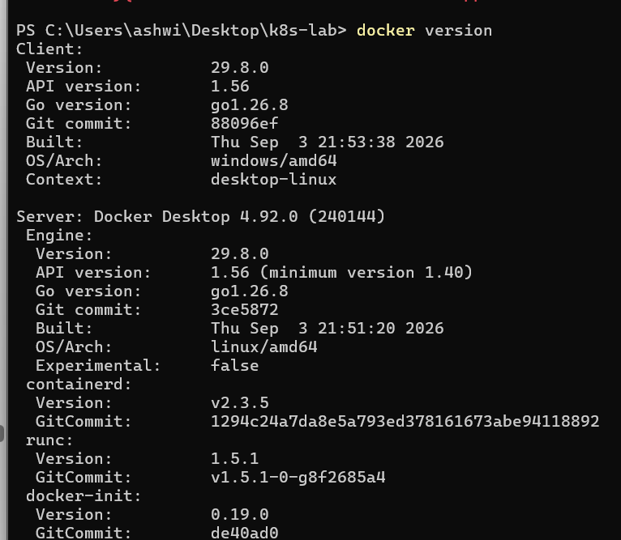

### 8.2 Docker Hello World

Demonstrates that Docker can successfully download an image, create a container, and execute it.

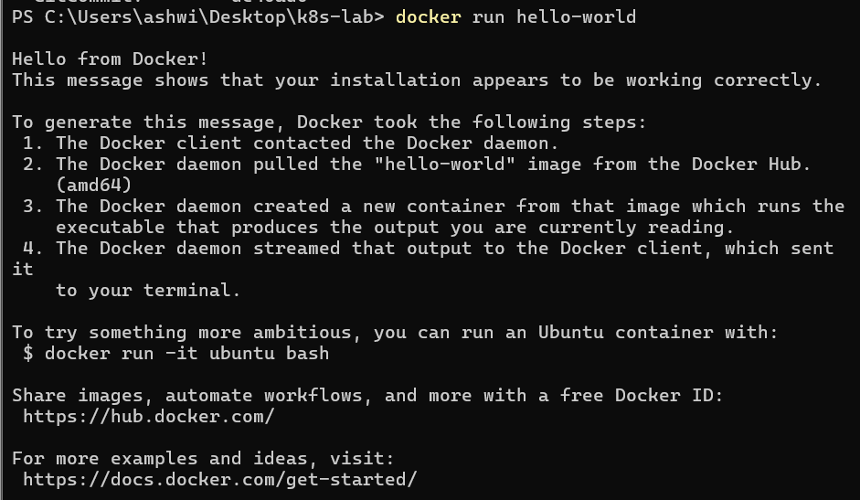

### 8.3 Kubernetes Cluster Creation

Shows the successful creation of the three-node Kubernetes cluster using kind.

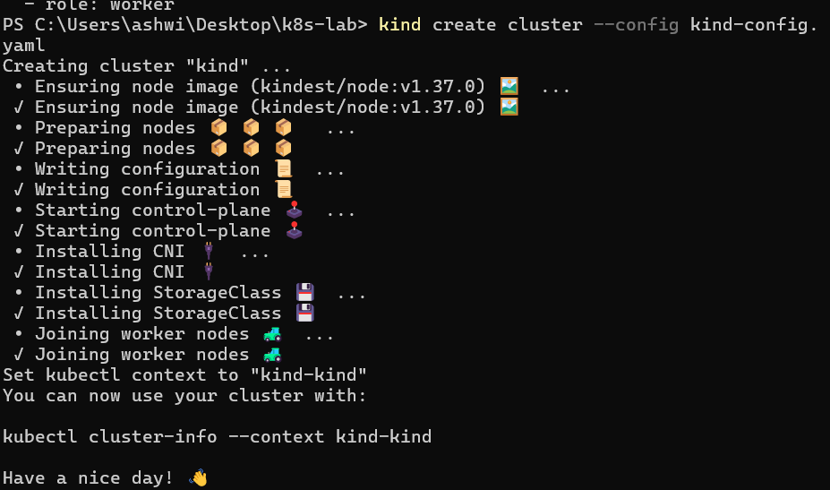

### 8.4 Kubernetes Node Status

Displays the Control Plane and two Worker nodes with their Ready status.

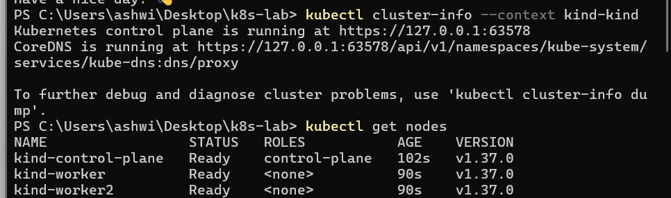

### 8.5 Docker Containers

Shows the three running Docker containers representing the Kubernetes nodes.

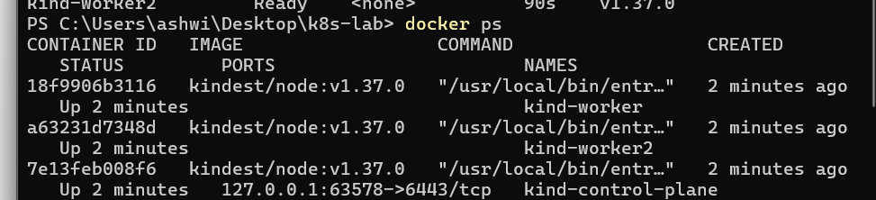

### 8.6 Kubernetes System Pods

Displays Kubernetes system components such as CoreDNS, etcd, API Server, Scheduler, Controller Manager, and kube-proxy.

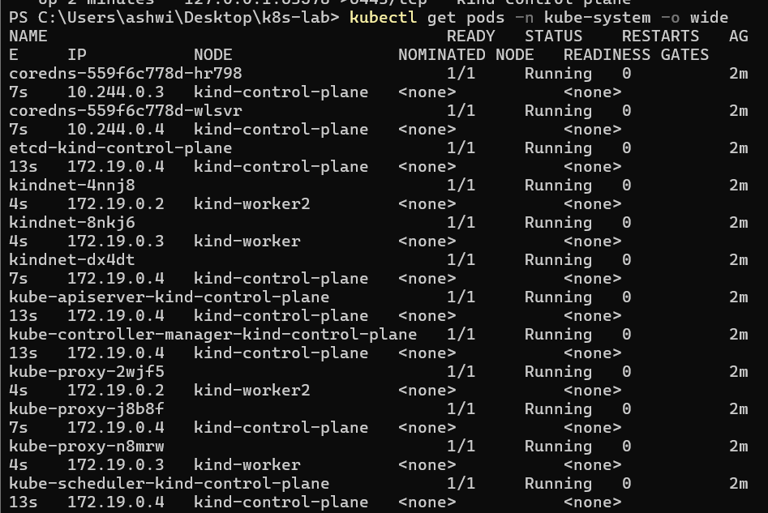

### 8.7 NGINX Deployment

Shows the successful creation of the NGINX Deployment with three replicas.

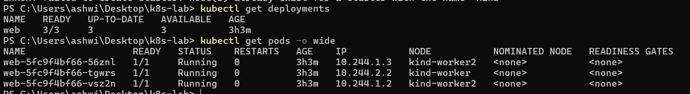

### 8.8 NGINX Pods

Displays the three running NGINX Pods along with their IP addresses and Worker node assignments.

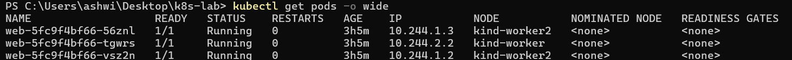

### 8.9 Horizontal Scaling

Demonstrates the successful increase in NGINX replicas from three to six.

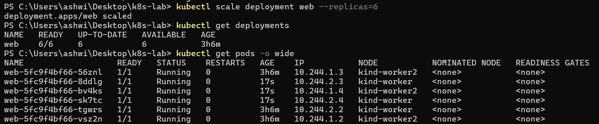

### 8.10 Self-Healing Demonstration

Shows the deletion of a running Pod and the automatic creation of a replacement Pod by Kubernetes.

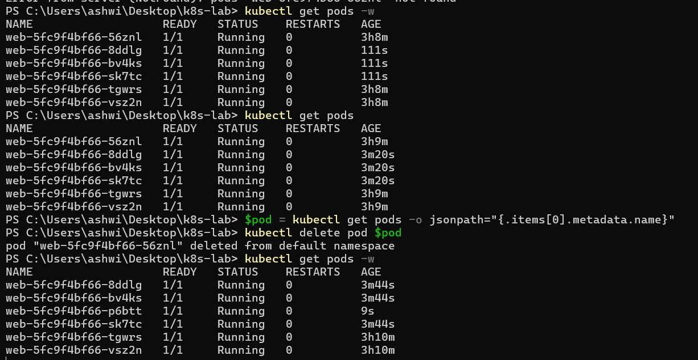

## 9. Important Kubernetes Commands

| Command                                         | Description                            |
| :---------------------------------------------- | :------------------------------------- |
| `docker version`                                | Checks Docker installation             |
| `docker run hello-world`                        | Tests Docker container execution       |
| `docker ps`                                     | Lists running Docker containers        |
| `kind version`                                  | Displays kind version                  |
| `kubectl version --client`                      | Displays kubectl version               |
| `kind create cluster --config kind-config.yaml` | Creates the Kubernetes cluster         |
| `kubectl cluster-info`                          | Displays cluster information           |
| `kubectl get nodes`                             | Lists Kubernetes nodes                 |
| `kubectl get pods -n kube-system -o wide`       | Lists system Pods                      |
| `kubectl get deployments`                       | Lists Deployments                      |
| `kubectl get pods -o wide`                      | Displays Pods and node assignments     |
| `kubectl scale deployment web --replicas=6`     | Scales the application to six replicas |
| `kubectl delete pod <pod-name>`                 | Deletes a selected Pod                 |
| `kubectl get pods -w`                           | Continuously monitors Pod changes      |

## 10. Key Learnings

Through this experiment, the following concepts were understood:

* Kubernetes cluster architecture and node management.
* Difference between Control Plane and Worker nodes.
* Containerization using Docker.
* Creating multi-node Kubernetes clusters using kind.
* Deploying applications using Kubernetes Deployments.
* Understanding Pods and ReplicaSets.
* Horizontal scaling of application replicas.
* Kubernetes scheduling and workload distribution.
* Automatic Pod replacement through self-healing.

## 11. Conclusion

This experiment successfully demonstrates the fundamental capabilities of Kubernetes for container orchestration.

A three-node Kubernetes cluster was created locally using Docker Desktop and kind. An NGINX application was deployed with three replicas and subsequently scaled to six replicas.

The self-healing capability was demonstrated by manually deleting a running Pod and observing Kubernetes automatically create a replacement.

Overall, this experiment provides practical understanding of Kubernetes architecture, container management, application deployment, horizontal scaling, and automated workload recovery.

---

<p align="center">
  <b>KUBERNETES CLUSTER LAB</b>
  <br>
  Container Orchestration | Horizontal Scaling | Self-Healing
  <br><br>
  <i>Implemented on Windows using Docker Desktop and kind.</i>
</p>
