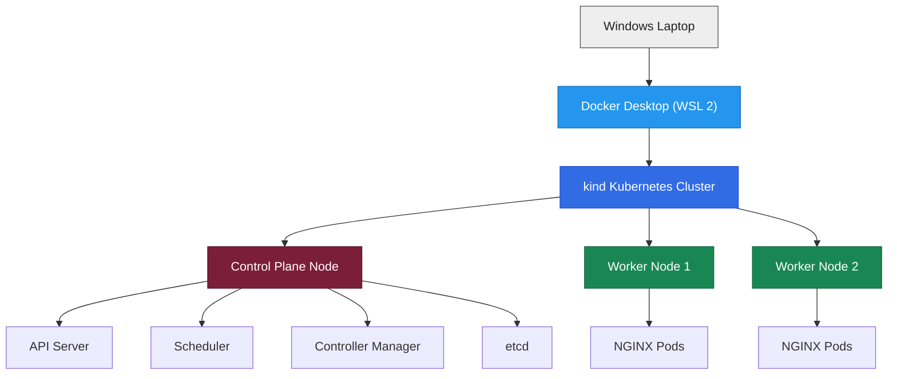

# Kubernetes Cluster Lab on Windows

### Building a Three-Node Kubernetes Cluster Using Docker Desktop and kind

<p align="center">
  
  
  
  
</p>

---

## 1. Project Overview

This project demonstrates the implementation of a local Kubernetes cluster on a Windows machine using Docker Desktop and kind (Kubernetes IN Docker).

A three-node Kubernetes cluster is created, consisting of one Control Plane node and two Worker nodes. An NGINX web server is deployed inside the cluster using Kubernetes Deployments.

The experiment demonstrates how Kubernetes manages containerized applications through deployment, horizontal scaling, and automatic recovery of deleted Pods.

The complete implementation is performed locally without requiring cloud infrastructure or multiple physical machines.

## 2. Objectives

The primary objectives of this experiment are:

* Understand Kubernetes architecture and container orchestration.
* Create a multi-node Kubernetes cluster using kind.
* Understand the roles of Control Plane and Worker nodes.
* Deploy an NGINX application using Kubernetes Deployments.
* Monitor Pods and their distribution across Worker nodes.
* Demonstrate horizontal scaling by increasing replicas from 3 to 6.
* Demonstrate Kubernetes self-healing by deleting a Pod and observing its automatic replacement.
* Understand how Docker containers are used to run Kubernetes nodes.

## 3. Technologies Used

| Technology     | Purpose                                       |
| -------------- | --------------------------------------------- |
| Windows 10/11  | Host operating system                         |
| WSL 2          | Linux environment for Docker Desktop          |
| Docker Desktop | Container runtime environment                 |
| Kubernetes     | Container orchestration platform              |
| kind           | Creates a local multi-node Kubernetes cluster |
| kubectl        | Command-line interface for Kubernetes         |
| NGINX          | Web server deployed inside Kubernetes         |
| YAML           | Cluster configuration                         |

## 4. System Architecture

The experiment uses a three-node Kubernetes cluster.

### Cluster Architecture



### Node Configuration

| Node               | Role          | Responsibility                 |
| ------------------ | ------------- | ------------------------------ |
| kind-control-plane | Control Plane | Manages the Kubernetes cluster |
| kind-worker        | Worker        | Runs application workloads     |
| kind-worker2       | Worker        | Runs application workloads     |

All three Kubernetes nodes run as Docker containers on the local Windows machine.

### Control Plane Components

| Component          | Description                                                    |
| ------------------ | -------------------------------------------------------------- |
| API Server         | Handles communication between Kubernetes components and users. |
| Scheduler          | Selects suitable nodes for newly created Pods.                 |
| Controller Manager | Maintains the desired state of the cluster.                    |
| etcd               | Stores Kubernetes cluster configuration and state.             |

## 5. Project Structure

```text
Kubernetes-Cluster-Lab/
│
├── README.md
│
├── kind-config.yaml
│
└── results/
    ├── cluster-creation.png
    ├── nodes-status.png
    ├── nginx-deployment.png
    ├── scaling.png
    └── self-healing.png
```

### File Description

* **README.md:** Project documentation, architecture, implementation, and results.
* **kind-config.yaml:** Defines the three-node Kubernetes cluster.
* **results/:** Contains screenshots demonstrating the successful execution of the experiment.

## 6. Cluster Configuration

The Kubernetes cluster is configured using a YAML file named `kind-config.yaml`.

### Configuration File

```yaml
kind: Cluster
apiVersion: kind.x-k8s.io/v1alpha4

nodes:
  - role: control-plane
  - role: worker
  - role: worker
```

### Configuration Explanation

| Parameter     | Description                                   |
| ------------- | --------------------------------------------- |
| kind          | Defines the resource type as Cluster.         |
| apiVersion    | Specifies the kind configuration API version. |
| control-plane | Creates one Control Plane node.               |
| worker        | Creates the first Worker node.                |
| worker        | Creates the second Worker node.               |

This configuration instructs kind to create a Kubernetes cluster containing three nodes.

## 7. Implementation Workflow

The experiment is divided into six major parts.

### Part 1: Installation of Required Tools

The following tools are installed:

1. WSL 2
2. Docker Desktop
3. kubectl
4. kind

Docker Desktop is configured to use the WSL 2 backend.

### Part 2: Verification of Tools

The installations are verified using the following commands:

```powershell
docker version
docker run hello-world
kubectl version --client
kind version
```

These commands verify Docker functionality and the availability of kubectl and kind.

### Part 3: Creating Cluster Configuration

A project directory is created, and the `kind-config.yaml` file is added.

The configuration defines one Control Plane and two Worker nodes.

### Part 4: Creating the Kubernetes Cluster

The cluster is created using:

```powershell
kind create cluster --config kind-config.yaml
```

kind reads the YAML configuration and creates three Docker containers representing the Kubernetes nodes.

The Worker nodes then join the Control Plane to form the cluster.

Cluster connectivity is verified using:

```powershell
kubectl cluster-info --context kind-kind
```

Node status is checked using:

```powershell
kubectl get nodes
```

### Part 5: Deploying NGINX

An NGINX Deployment is created with three replicas.

```powershell
kubectl create deployment web --image=nginx --replicas=3
```

Kubernetes creates the required Pods and schedules them on available Worker nodes.

Verify the Deployment:

```powershell
kubectl get deployments
```

Check the Pods:

```powershell
kubectl get pods -o wide
```

The output displays the Pod names, status, IP addresses, and the nodes on which they are running.

### Part 6: Scaling and Self-Healing

#### A. Horizontal Scaling

The application is initially deployed with three replicas.

To increase the number of replicas to six:

```powershell
kubectl scale deployment web --replicas=6
```

Verify the Pods:

```powershell
kubectl get pods -o wide
```

Kubernetes creates three additional Pods to reach the desired replica count.

#### B. Self-Healing

To demonstrate self-healing, one running Pod is manually deleted.

First, list the Pods:

```powershell
kubectl get pods
```

Delete one Pod:

```powershell
kubectl delete pod <pod-name>
```

Observe the changes:

```powershell
kubectl get pods -w
```

The ReplicaSet controller detects that the actual number of Pods is lower than the desired number.

Kubernetes automatically creates a replacement Pod.

The Deployment eventually returns to six running replicas.

This demonstrates Kubernetes self-healing.

## 8. Execution Results and Screenshots

The following screenshots provide evidence of the experiment.

### 8.1 Cluster Creation

Shows the successful creation of the Kubernetes cluster using kind.


### 8.2 Kubernetes Node Status

Displays the three Kubernetes nodes with their Ready status.


### 8.3 NGINX Deployment

Shows the successful creation of the NGINX Deployment.


### 8.4 Horizontal Scaling

Demonstrates the increase in NGINX Pods from three to six.


### 8.5 Self-Healing

Shows Kubernetes automatically replacing a manually deleted Pod.


## 9. Important Kubernetes Commands

| Command                                         | Description                               |
| ----------------------------------------------- | ----------------------------------------- |
| `docker version`                                | Checks Docker installation.               |
| `docker ps`                                     | Lists running Docker containers.          |
| `kind version`                                  | Displays kind version.                    |
| `kubectl version --client`                      | Displays kubectl version.                 |
| `kind create cluster --config kind-config.yaml` | Creates the Kubernetes cluster.           |
| `kubectl cluster-info`                          | Displays cluster information.             |
| `kubectl get nodes`                             | Lists cluster nodes.                      |
| `kubectl get pods -n kube-system`               | Lists Kubernetes system Pods.             |
| `kubectl get deployments`                       | Lists Deployments.                        |
| `kubectl get pods -o wide`                      | Displays Pods and their node assignments. |
| `kubectl scale deployment web --replicas=6`     | Scales the application to six replicas.   |
| `kubectl delete pod <pod-name>`                 | Deletes a selected Pod.                   |
| `kubectl get pods -w`                           | Continuously monitors Pod changes.        |

## 10. Key Learnings

Through this experiment, the following concepts were understood:

* Kubernetes cluster architecture and node management.
* Difference between Control Plane and Worker nodes.
* Containerization using Docker.
* Creating multi-node Kubernetes clusters using kind.
* Deploying applications using Kubernetes Deployments.
* Understanding Pods and ReplicaSets.
* Horizontal scaling of application replicas.
* Kubernetes scheduling and workload distribution.
* Automatic Pod replacement through self-healing.

## 11. Conclusion

This experiment successfully demonstrates the fundamental capabilities of Kubernetes for container orchestration.

A three-node Kubernetes cluster is configured locally using Docker Desktop and kind. An NGINX application is deployed with three replicas and subsequently scaled to six replicas.

The self-healing capability is demonstrated by manually deleting a Pod and observing Kubernetes automatically create a replacement.

Overall, this experiment provides practical understanding of Kubernetes architecture, application deployment, horizontal scaling, and automated workload management.

---

<p align="center">
  <b>Kubernetes Cluster Lab</b><br>
  Container Orchestration | Horizontal Scaling | Self-Healing
</p>
